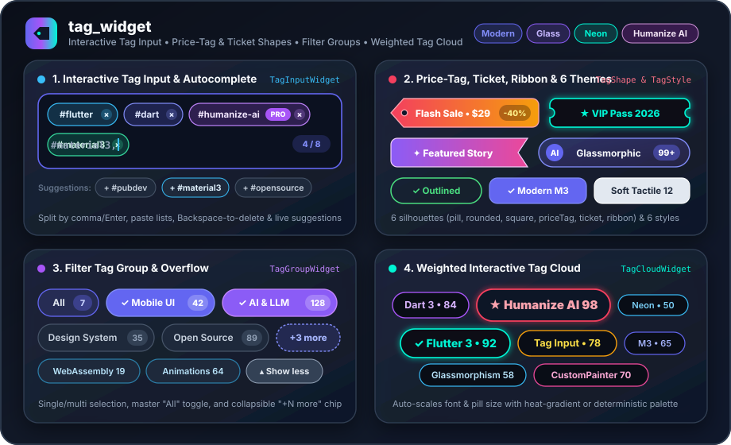
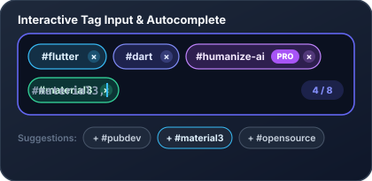
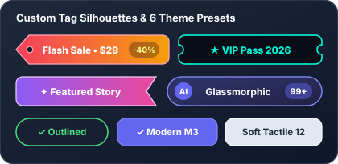
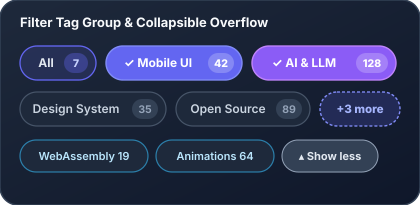
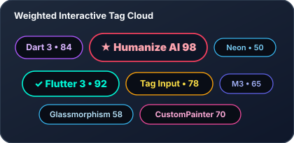

# tag_widget

[](https://pub.dev/packages/tag_widget)
[](https://opensource.org/licenses/MIT)
[](https://flutter.dev)
[](https://pub.dev/packages/tag_widget)
[](https://humanize.id)

A modern, powerful, and highly customizable Flutter tag & chip widget library featuring interactive tag input with live autocomplete, single/multi-select filter tag groups with collapsible `+N more` overflow, physical price-tag & perforated ticket silhouettes, 6 theme presets, and weighted interactive tag clouds. Zero external dependencies and full `FormField` integration.

> 🌟 Supported & Powered by [Humanize AI](https://humanize.id)

<p align="center">
  
</p>

---

## 🎬 Live Visual Preview

| 1. Interactive Tag Input (`TagInputWidget`) | 2. Custom Shapes & 6 Themes (`TagShape` & `TagStyle`) |
| :---: | :---: |
|  |  |
| Multi-delimiter tag creation (`,`, `;`, `Enter`), clipboard paste splitting, Backspace-to-delete, prefix formatting (`#`, `@`), and live autocomplete suggestions. | Vector `priceTag` (with punch hole), `ticket`, `ribbon`, `pill`, `rounded`, and `square` shapes across 6 theme presets. |

| 3. Filter Tag Group & Overflow (`TagGroupWidget`) | 4. Weighted Tag Cloud (`TagCloudWidget`) |
| :---: | :---: |
|  |  |
| Single-select and multi-select filter chips with count badges, master `"All"` chip, and collapsible `+N more` overflow expansion. | Dynamic font/pill scaling and heat-gradient or deterministic palette coloring based on tag weight. |

---

## ✨ Features

- 🏷️ **6 Vector Tag Silhouettes** (`TagShape` & `TagShapePainter`):
  - `TagShape.pill` — Full stadium capsule with circular ends.
  - `TagShape.rounded` — Balanced modern rounded rectangle.
  - `TagShape.square` — Crisp minimal badge with subtle 4px corners.
  - `TagShape.priceTag` — Physical retail price-tag silhouette with angled left pointer and circular punch-hole.
  - `TagShape.ticket` — Perforated event ticket / coupon badge with semicircular side notches.
  - `TagShape.ribbon` — Bookmark ribbon banner with chevron tail notch.
- 🎨 **6 Built-in Theme Presets** (`TagStyle`):
  - `TagStyle.modern()` — Clean Material 3 tonal surface with crisp border and elevated selection state.
  - `TagStyle.glass()` — Translucent frosted glassmorphic capsule with luminous border.
  - `TagStyle.neon()` — High-contrast dark cyber style with glowing neon stroke and outer glow.
  - `TagStyle.gradient()` — Vibrant multi-stop linear gradient background.
  - `TagStyle.outlined()` — Transparent surface with bold colored outline.
  - `TagStyle.soft()` — Tactile soft-UI / neumorphic contours with dual ambient shadows.
- ⌨️ **Interactive Tag Input & Live Autocomplete** (`TagInputWidget`):
  - Automatic tag creation on `Enter` or configurable delimiters (`,`, `;`, `\n`).
  - Smart multi-tag clipboard paste splitting.
  - Backspace navigation: first `Backspace` on an empty input highlights the last tag; second `Backspace` deletes it (configurable via `confirmDeleteOnBackspace`).
  - Automatic prefix injection (`#` for hashtags, `@` for mentions) and case normalization (`preserve`, `lowercase`, `uppercase`, `titleCase`).
  - Built-in filterable autocomplete suggestion chips (`suggestions`).
  - Three layout modes: `TagInputLayout.wrap`, `TagInputLayout.scrollableHorizontal`, and `TagInputLayout.stacked`.
- 🧩 **Filter Tag Groups & Collapsible Overflow** (`TagGroupWidget`):
  - `TagSelectionMode.single`, `TagSelectionMode.multiple` (with optional `maxSelected`), or `TagSelectionMode.none`.
  - Optional master `"All"` toggle chip (`showAllTag: true`).
  - Collapsible overflow (`maxVisibleTags`): automatically groups extra tags behind an interactive `+N more` / `Show less` toggle chip.
- ☁️ **Weighted Interactive Tag Cloud** (`TagCloudWidget`):
  - Scales each tag between `minScale` and `maxScale` according to its `weight` or `count`.
  - Supports `TagCloudColorMode.heat` (cool-to-hot gradient), `TagCloudColorMode.palette`, and `TagCloudColorMode.style`.
- 📋 **Form Validation & Programmatic Control**:
  - `TagFormField` integrates directly with Flutter's `Form`, `validator`, `onSaved`, `reset()`, and `AutovalidateMode`.
  - `TagController` provides full programmatic CRUD, selection management, search filtering, and alphabetical/weight sorting.

---

## 📦 Installation

Add `tag_widget` to your `pubspec.yaml`:

```yaml
dependencies:
  tag_widget: ^1.0.0
```

Or install via the Flutter CLI:

```bash
flutter pub add tag_widget
```

---

## 🚀 Quick Start

```dart
import 'package:flutter/material.dart';
import 'package:tag_widget/tag_widget.dart';

class QuickTagDemo extends StatelessWidget {
  const QuickTagDemo({super.key});

  @override
  Widget build(BuildContext context) {
    return Wrap(
      spacing: 8,
      runSpacing: 8,
      children: [
        TagWidget(
          label: 'Flutter 3',
          icon: Icons.flutter_dash,
          count: 128,
          selected: true,
          style: TagStyle.modern(),
          onTap: () {},
        ),
        TagWidget(
          label: r'Flash Sale • $29',
          badgeText: '-40%',
          selected: true,
          style: TagStyle.gradient(
            startColor: const Color(0xFFF43F5E),
            endColor: const Color(0xFFF59E0B),
            shape: TagShape.priceTag,
            showSelectedCheckmark: false,
          ),
          onTap: () {},
        ),
      ],
    );
  }
}
```

---

## 📖 Usage Examples

### 1. Interactive Tag Input with Autocomplete (`TagInputWidget`)

```dart
final tagController = TagController(
  initialTags: TagItem.fromLabels(
    ['#flutter', '#dart'],
    autoColor: true,
  ),
  prefix: '#',
  caseMode: TagCaseMode.lowercase,
  maxTags: 8,
  autoColorNewTags: true,
);

TagInputWidget(
  controller: tagController,
  labelText: 'Article Hashtags',
  hintText: 'Type a topic or comma...',
  prefixIcon: Icons.tag_rounded,
  tagStyle: TagStyle.glass(),
  showSuggestionsWhenEmpty: true,
  suggestions: const [
    '#widget',
    '#pubdev',
    '#material3',
    '#opensource',
    '#humanize-ai',
  ],
  onChanged: (tags) {
    debugPrint('Active tags: ${tags.map((t) => t.label).toList()}');
  },
);
```

### 2. Custom Silhouettes (`priceTag`, `ticket`, `ribbon`) & Theme Presets

```dart
// 1. Physical Retail Price-Tag with Punch Hole
TagWidget(
  label: r'Pro Plan • $19/mo',
  badgeText: 'SAVE 30%',
  selected: true,
  style: TagStyle.gradient(
    startColor: const Color(0xFFF43F5E),
    endColor: const Color(0xFFF59E0B),
    shape: TagShape.priceTag,
    showSelectedCheckmark: false,
  ),
)

// 2. Perforated Event Ticket in Glowing Neon Cyber Style
TagWidget(
  label: 'VIP Backstage Pass',
  icon: Icons.confirmation_num_outlined,
  selected: true,
  style: TagStyle.neon(
    accentColor: const Color(0xFF00F5D4),
    shape: TagShape.ticket,
    showSelectedCheckmark: false,
  ),
)

// 3. Bookmark Ribbon Banner
TagWidget(
  label: 'Editor Choice',
  icon: Icons.bookmark_added_rounded,
  selected: true,
  style: TagStyle.modern(
    accentColor: const Color(0xFF8B5CF6),
    shape: TagShape.ribbon,
    showSelectedCheckmark: false,
  ),
)
```

### 3. Filter Tag Group with `"All"` & Collapsible `"+N more"` (`TagGroupWidget`)

```dart
TagGroupWidget(
  labelText: 'Filter Categories',
  showAllTag: true,
  maxVisibleTags: 4, // Collapses remaining tags into an expandable "+N more" chip
  selectionMode: TagSelectionMode.multiple,
  style: TagStyle.glass(accentColor: const Color(0xFF6366F1)),
  tags: const [
    TagItem(label: 'Mobile UI', count: 42, selected: true),
    TagItem(label: 'AI & LLM', count: 128, selected: true),
    TagItem(label: 'Design System', count: 35),
    TagItem(label: 'Open Source', count: 89),
    TagItem(label: 'WebAssembly', count: 19),
    TagItem(label: 'Animations', count: 64),
  ],
  onSelectionChanged: (selected) {
    debugPrint('Selected filters: ${selected.map((e) => e.label).toList()}');
  },
)
```

### 4. Weighted Interactive Tag Cloud (`TagCloudWidget`)

```dart
TagCloudWidget(
  labelText: 'Trending Topics',
  colorMode: TagCloudColorMode.heat,
  showWeightAsCount: true,
  minScale: 0.85,
  maxScale: 1.35,
  style: TagStyle.neon(),
  tags: const [
    TagItem(label: 'Humanize AI', weight: 98, selected: true),
    TagItem(label: 'Flutter 3', weight: 92),
    TagItem(label: 'Dart 3', weight: 84),
    TagItem(label: 'Tag Input', weight: 78),
    TagItem(label: 'Price Tag', weight: 72),
    TagItem(label: 'Material 3', weight: 65),
    TagItem(label: 'Glassmorphism', weight: 55),
  ],
)
```

### 5. Form Validation (`TagFormField`)

```dart
TagFormField(
  labelText: 'Project Skills (Minimum 2 required)',
  initialValue: TagItem.fromLabels(['Flutter'], autoColor: true),
  tagStyle: TagStyle.modern(),
  autovalidateMode: AutovalidateMode.onUserInteraction,
  validator: (tags) {
    if (tags == null || tags.length < 2) {
      return 'Please add at least 2 skill tags';
    }
    return null;
  },
  onSaved: (tags) {
    debugPrint('Saved tags: ${tags?.map((t) => t.label).toList()}');
  },
)
```

---

## ⌨️ Gestures & Keyboard Controls

| Interaction | Action |
| :--- | :--- |
| **Tap Tag** | Toggles selection state or triggers `onTap` callback |
| **Tap `×` Button** | Removes the tag and invokes `onDeleted` |
| **Type `,` / `;` / `Enter`** | Converts typed text into a new tag pill in `TagInputWidget` |
| **Paste Comma/Newline Text** | Automatically splits and adds multiple tags at once |
| **`Backspace` (Empty Input)** | Highlights the last tag on first press, deletes it on second press |
| **`Escape` (Input Focused)** | Clears pending backspace highlight on the last tag |
| **Tap Suggestion Chip** | Appends the suggested tag and clears the current query |
| **Tap `+N more` / `Show less`** | Expands or collapses overflow tags in `TagGroupWidget` |

---

## 💖 Support & Sponsor

This open-source library is proudly supported and powered by **[Humanize AI](https://humanize.id)** — an advanced AI platform for natural and human-like content generation.

- **Website**: [Humanize AI](https://humanize.id)
- **Repository**: [https://github.com/andikpbw/flutter-tag-widget.git](https://github.com/andikpbw/flutter-tag-widget.git)
- **Issue Tracker**: [GitHub Issues](https://github.com/andikpbw/flutter-tag-widget/issues)

---

## 📄 License

Released under the [MIT License](LICENSE).
